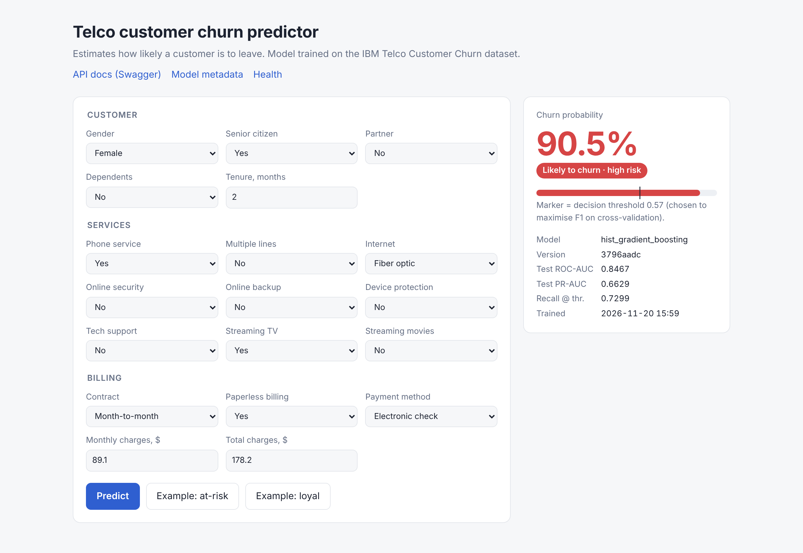
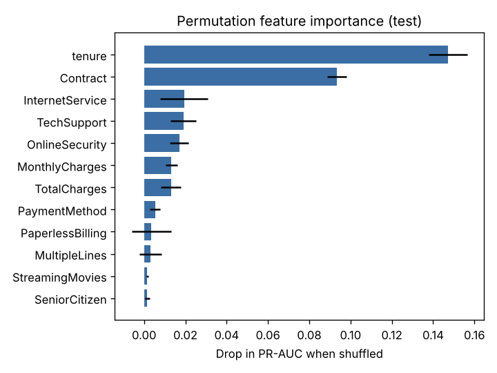
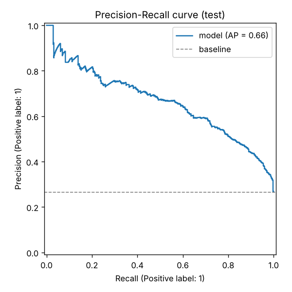
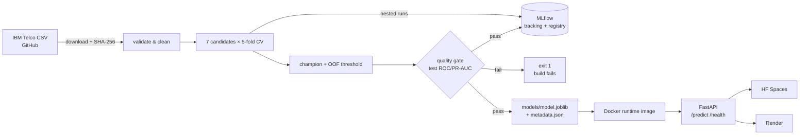
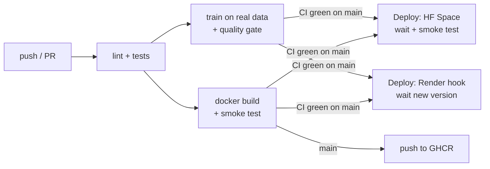
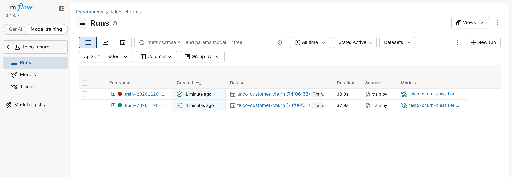

# Telco Churn Prediction: от эксперимента до продакшена

[](https://github.com/Zxcurilwik/telco-churn-mlops/actions/workflows/ci.yml)
[](https://github.com/<USER>/<REPO>/actions/workflows/deploy.yml)


Сервис предсказывает вероятность ухода (churn) клиента телеком-оператора.
Это не ноутбук, а весь путь модели до продакшена:

**данные → эксперименты в MLflow → quality gate → Docker → CI → автодеплой (Hugging Face Spaces / Render) → REST API + демо-UI**

> 🔗 **Демо:** `https://telco-churn-mlops-0l8a.onrender.com` 



---

## Что внутри

| Слой | Что сделано |
|---|---|
| **Данные** | Публичный датасет [IBM Telco Customer Churn](https://github.com/IBM/telco-customer-churn-on-icp4d) (7 043 клиента, 26.5% ушли). Скачивается автоматически, **проверяется SHA-256**, валидируется схема (колонки, дубликаты ID, значения таргета). |
| **Фичи** | sklearn `Pipeline`: инженерные признаки (число подключённых услуг, средний платёж за всё время, отношение текущего платежа к среднему) + импутация, скейлинг, one-hot. Препроцессинг живёт **внутри артефакта модели**, поэтому train/serve skew невозможен. |
| **Эксперименты** | 3 семейства моделей × сетка гиперпараметров = 7 кандидатов. Каждый кандидат — **вложенный MLflow run** с параметрами, метриками 5-fold CV и метриками по фолдам. В родительский run пишутся датасет (`mlflow.log_input`), конфиг, лидерборд, графики (ROC, PR, confusion matrix, permutation importance) и модель с сигнатурой. |
| **Выбор модели** | Чемпион выбирается по среднему **PR-AUC на CV** (классы несбалансированы). Порог решения подбирается по **out-of-fold** предсказаниям (максимум F1), тестовая выборка используется **один раз**. |
| **Model Registry** | Модель регистрируется в MLflow Model Registry, на новую версию вешается алиас `champion`. |
| **Quality gate** | Если на hold-out ROC-AUC < 0.80 или PR-AUC < 0.60, обучение падает с exit code 1, модель не регистрируется и не экспортируется. Это останавливает и CI, и `docker build`. |
| **API** | FastAPI: строгая Pydantic-валидация (enum-значения, диапазоны, бизнес-инварианты вроде «нет интернета → нет онлайн-услуг»), батч-предсказания, `/health`, `/model/info`, request-id и время обработки в заголовках, fail-fast при старте без модели. |
| **Docker** | Multi-stage: стадия `model` обучает модель прямо во время сборки, runtime-образ содержит только сервинг-зависимости и артефакт. Non-root пользователь, `HEALTHCHECK`, порт из `$PORT`. |
| **CI** | GitHub Actions: ruff → pytest (покрытие 94%, без сети, на синтетических данных) → обучение на реальных данных с quality gate → сборка образа + smoke test контейнера → публикация образа в GHCR. |
| **CD** | После зелёного CI на `main`: загрузка на **Hugging Face Spaces** с ожиданием сборки и smoke-тестом живого URL; деплой на **Render** через deploy hook с ожиданием новой версии модели. |

## Результаты

Hold-out тест (1 409 клиентов, модель ни разу не видела их при обучении и выборе порога):

| Модель | ROC-AUC | PR-AUC | Recall | Precision | F1 | Порог |
|---|---|---|---|---|---|---|
| HistGradientBoosting (`lr=0.03`, `max_leaf_nodes=8`) | **0.847** | **0.663** | 0.730 | 0.554 | 0.630 | 0.574 |

Лидерборд кандидатов (5-fold CV на train, отсортирован по PR-AUC):

| Кандидат | CV ROC-AUC | CV PR-AUC (± std) |
|---|---|---|
| hist_gb[lr=0.03] | 0.847 | **0.661** ± 0.023 |
| random_forest[max_depth=10] | 0.847 | 0.660 ± 0.021 |
| logreg[C=0.3] | 0.845 | 0.658 ± 0.019 |
| logreg[C=1.0] | 0.846 | 0.658 ± 0.019 |
| logreg[C=0.05] | 0.845 | 0.658 ± 0.019 |
| random_forest[max_depth=6] | 0.846 | 0.657 ± 0.018 |
| hist_gb[lr=0.08] | 0.843 | 0.655 ± 0.022 |

**Честный вывод:** разница между кандидатами меньше стандартного отклонения по фолдам. На этих данных логистическая регрессия практически не уступает бустингу, и для продакшена её можно выбрать как более простую и интерпретируемую. Пайплайн выбирает модель автоматически по заранее заданному правилу; поменять правило можно в `configs/train.yaml`.

При пороге 0.574 модель находит **73% уходящих клиентов**, и примерно каждый второй из отмеченных действительно уходит. Для retention-кампании это разумный компромисс: удержать клиента дешевле, чем привлечь нового.

<p>
  
  
</p>

Сильнее всего на отток влияют срок жизни клиента (`tenure`) и тип контракта: помесячный контракт в первые месяцы означает высокий риск.

## Архитектура





## Быстрый старт

Нужен Python 3.12 (или только Docker).

### Вариант 1. Локально

```bash
python -m venv .venv && source .venv/bin/activate
```

```bash
make install
```

```bash
make train        # скачает данные, прогонит эксперименты, сохранит модель в models/
```

```bash
make mlflow-ui    # http://localhost:5000 — сравнение запусков, графики, registry
```

```bash
make serve        # http://localhost:8000 — демо, http://localhost:8000/docs — Swagger
```

```bash
make test         # тесты с покрытием
```

Без `make`: `pip install -r requirements-dev.txt && pip install -e .`, затем `python -m churn.train` и `uvicorn app.main:app --reload`.

### Вариант 2. Production-образ

```bash
docker build -t telco-churn-api .     # модель обучается внутри сборки
```

```bash
docker run --rm -p 8000:7860 telco-churn-api
```

### Вариант 3. Весь стек: MLflow-сервер + обучение + API

```bash
docker compose up --build
```

- MLflow UI: http://localhost:5000 (эксперимент `telco-churn`, модель `telco-churn-classifier@champion`)
- API и демо: http://localhost:8000

Сервис `train` пишет эксперименты на MLflow-сервер, `api` стартует только после успешного обучения и раздаёт свежую модель. Поменяйте гиперпараметры в `configs/train.yaml`, запустите `docker compose run --rm train` и сравните запуски в UI.



## API

| Метод | Путь | Описание |
|---|---|---|
| `GET` | `/` | Демо-страница с формой |
| `GET` | `/docs` | Swagger UI |
| `GET` | `/health` | Liveness/readiness + версия модели |
| `GET` | `/model/info` | Метаданные: модель, гиперпараметры, метрики, порог, MLflow run id |
| `POST` | `/predict` | Предсказание для одного клиента |
| `POST` | `/predict/batch` | До 1 000 клиентов за запрос |

```bash
curl -X POST http://localhost:8000/predict \
  -H "Content-Type: application/json" \
  -d @examples/customer.json
```

```json
{
  "customerID": "7590-VHVEG",
  "churn_probability": 0.8402,
  "churn": true,
  "risk_level": "high",
  "threshold": 0.5738,
  "model_version": "ac02f497"
}
```

```bash
curl -X POST http://localhost:8000/predict/batch \
  -H "Content-Type: application/json" \
  -d @examples/batch.json
```

Некорректный ввод (неизвестное значение, отрицательный `tenure`, лишнее поле, противоречивые услуги) получает `422` с понятным описанием ошибки и до модели не доходит.

`risk_level`: `high` — вероятность ≥ порога, `medium` — ≥ 60% порога, иначе `low`.

## Деплой

Деплой запускается workflow `Deploy` **только после зелёного CI на `main`**. Каждая платформа включается, когда заданы её секреты; без секретов шаг пропускается с пометкой, CI не падает.

### Hugging Face Spaces (бесплатно, рекомендую)

1. Зарегистрируйтесь на [huggingface.co](https://huggingface.co) и создайте токен с правом **Write**: *Settings → Access Tokens*.
2. В репозитории GitHub: *Settings → Secrets and variables → Actions*:
   - **Secret** `HF_TOKEN` — токен из шага 1;
   - **Variable** `HF_SPACE_ID` — например `your-hf-username/telco-churn`.
3. Сделайте push в `main`. CI пройдёт, затем `Deploy` создаст Docker Space (если его нет), загрузит код, дождётся сборки и прогонит smoke-тест по живому URL `https://<user>-telco-churn.hf.space`.

Ручной деплой без GitHub:

```bash
HF_TOKEN=hf_xxx python scripts/deploy_hf_space.py --space your-hf-username/telco-churn --wait
```

> Space создаётся публичным: так smoke-тест из CI может достучаться до него. Карточка Space лежит в `deploy/huggingface/README.md`.

### Render

1. На [render.com](https://render.com): *New → Blueprint* → выберите репозиторий. Render прочитает `render.yaml` (Docker, free plan, health check `/health`, авто-деплой выключен).
2. В настройках сервиса: *Settings → Deploy Hook* → скопируйте URL.
3. В GitHub добавьте **Secret** `RENDER_DEPLOY_HOOK_URL` и (опционально) **Variable** `RENDER_APP_URL` = `https://telco-churn-api.onrender.com`.
4. После push в `main` CI дёрнет hook, дождётся, пока `/health` вернёт новую `model_version`, и прогонит smoke-тест.

> Free-инстанс Render засыпает без трафика, первый запрос после простоя может идти ~1 минуту. Альтернатива deploy hook — включить в настройках сервиса *Auto-Deploy → After CI Checks Pass*.

### GitHub Container Registry

На каждом push в `main` протестированный образ публикуется в `ghcr.io/<user>/<repo>:latest` и `:sha-<commit>`. Его можно запустить на любом хостинге, который умеет Docker.

## Структура проекта

```
├── .github/workflows/
│   ├── ci.yml              # lint → tests → train + quality gate → docker + smoke → GHCR
│   └── deploy.yml          # после зелёного CI: HF Spaces + Render
├── app/                    # FastAPI-сервис
│   ├── main.py             #   роуты, middleware, lifespan (загрузка модели)
│   ├── schemas.py          #   Pydantic-контракты + бизнес-валидация
│   ├── model_service.py    #   загрузка артефакта, предсказания
│   ├── settings.py         #   конфиг из env (MODEL_DIR, LOG_LEVEL)
│   └── static/index.html   #   демо-UI
├── src/churn/              # ML-пакет
│   ├── data.py             #   загрузка + SHA-256, валидация, очистка, split
│   ├── features.py         #   инженерные признаки, препроцессинг
│   ├── models.py           #   кандидаты и сетка гиперпараметров
│   ├── evaluate.py         #   метрики, подбор порога, графики, importance
│   ├── train.py            #   оркестрация: CV → выбор → тест → gate → MLflow → экспорт
│   └── config.py           #   типизированный конфиг (Pydantic)
├── configs/train.yaml      # все параметры обучения
├── tests/                  # 32 теста: данные, фичи, обучение + MLflow, API
├── scripts/
│   ├── smoke_test.py       # проверка любого живого инстанса
│   └── deploy_hf_space.py  # деплой на HF Spaces
├── deploy/huggingface/     # карточка Space
├── examples/               # примеры запросов
├── Dockerfile              # trainer → model → runtime
├── docker-compose.yml      # MLflow server + train + api
├── render.yaml             # Render Blueprint
├── Makefile
└── requirements*.txt       # runtime / train / dev, версии зафиксированы
```

## Инженерные решения

- **Почему модель обучается внутри `docker build`, а не лежит в git.** Образ самодостаточен и воспроизводим: одинаковые данные (проверка SHA-256), фиксированный seed и зафиксированные версии библиотек дают одну и ту же модель везде, где собирается образ (локальный запуск и сборка в Docker дали одинаковые метрики до 4-го знака). Бинарники не попадают в git, а quality gate стоит прямо в сборке: плохая модель не может стать образом.
- **Два формата модели.** `models/model.joblib` — лёгкий артефакт для сервинга: runtime-образ без MLflow весит ~700 МБ против 1.3 ГБ у обучающего. В MLflow модель логируется через **skops** (безопаснее pickle) вместе с кодом пакета `churn`, поэтому её можно загрузить из реестра в любом окружении: `mlflow.pyfunc.load_model("models:/telco-churn-classifier@champion")`.
- **Тестовая выборка неприкосновенна.** Выбор модели и порога идут только на train через CV/OOF, тест используется один раз для финальной оценки.
- **Тесты без сети.** Синтетический датасет с той же схемой и обучаемым сигналом, поэтому тесты быстрые и стабильные. Реальные данные проверяются отдельным CI-джобом.
- **Fail fast.** Без модели сервис не стартует, а не возвращает 500 на каждом запросе. Платформа увидит падение health check и не переключит трафик.

## Что можно улучшить

- Калибровка вероятностей (`CalibratedClassifierCV`): из-за `class_weight="balanced"` вероятности завышены (Brier 0.16).
- Подбор порога по бизнес-метрике (стоимость удержания vs потерянная выручка) вместо F1.
- Мониторинг: Prometheus-метрики, логирование предсказаний, контроль дрейфа данных (Evidently).
- Объяснение отдельных предсказаний (SHAP) в ответе API.
- Нагрузочное тестирование (Locust) и подбор числа воркеров.

## Данные

IBM Sample Data Sets, *Telco Customer Churn*: [IBM/telco-customer-churn-on-icp4d](https://github.com/IBM/telco-customer-churn-on-icp4d/blob/master/data/Telco-Customer-Churn.csv). Каждая строка — клиент: демография, подключённые услуги, контракт, платежи и факт ухода за последний месяц.

## Лицензия

MIT
